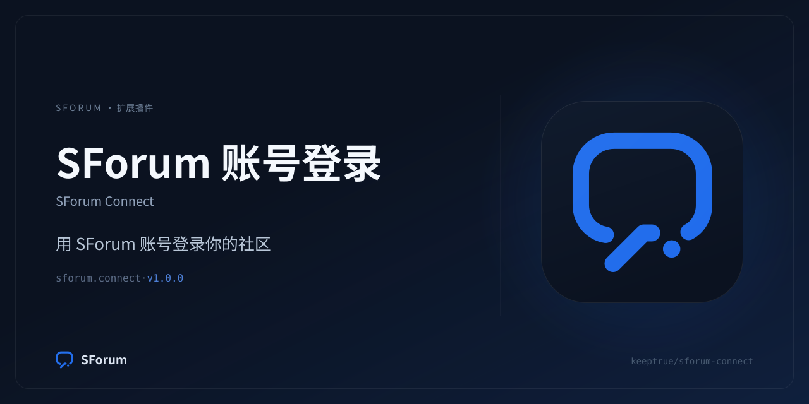

# SForum Connect

[](https://github.com/keeptrue/sforum-connect/actions/workflows/ci.yml)
[](https://github.com/keeptrue/sforum-connect/releases)



让**任意 SForum 站点**把另一个 SForum 站点（默认官方站 `https://bbs.dalao.me`）当作
OAuth2 授权服务器：用户点「使用 SForum 继续」，在那边登录并确认，然后带着授权码回来。
账号、密码、回调状态、PKCE 与会话全部由 Host 持有——本插件只做一件事：证明远端身份。

- 形态：SForum 扩展包（Manifest V3 + Protocol V2 后端 + `identity.runtime@1`），
  无自有数据表、无路由、无前端资源。
- 协议：Authorization Code + PKCE S256；访问令牌只用于读一次 userinfo，随后丢弃。
- 可配置：站点根地址（默认 `https://bbs.dalao.me`，允许路径前缀）、client_id、client_secret。

## 它解决什么问题

自建 SForum 想复用官方站（或另一个 SForum 社区）的账号体系，而不把密码交给任何第三方：

```
用户浏览器 ──▶ 本站 /auth/providers/sforum.connect.auth/start
                    │  Host 生成 state + PKCE verifier
                    ▼
             远端 /api/oauth/authorize  ── 用户登录 + 确认 ──▶ 回跳本站 callback
                    │
                    ▼
              插件：code + verifier ──▶ /api/oauth/token ──▶ /api/oauth/userinfo
                    │
                    ▼
             只回传 providerSubject + 昵称/显示名/邮箱提示
                    ▼
              Host 建会话 / 建账号 / 绑定已有账号
```

## 边界

| 插件做 | Host 独占 |
| --- | --- |
| 用 Host 给的 `state` / PKCE challenge / 绝对回调地址拼授权 URL | `state`、PKCE verifier、回调事务、绝对回调地址 |
| 用授权码换令牌，读一次 userinfo，返回原始 `providerSubject` | subject HMAC digest、用户、链接、角色、风控、会话 |
| 身份证明后立即丢弃访问令牌 | 公开激活、限流、审计、公开错误映射 |

插件不接触密码，不保存令牌，不建表，不注册任何路由。

## 安装

1. 从 [Releases](https://github.com/keeptrue/sforum-connect/releases) 下载与服务器平台匹配的压缩包
   （`linux_amd64` / `linux_arm64` / `darwin_arm64` / `darwin_amd64`），校验 `sha256sum -c SHA256SUMS`。
2. 装到 SForum（两种方式任选）：
   - **上传**：后台「插件管理 → 安装插件」选择 zip；
   - **外部源**：解压到某个外部源根的 `plugins/sforum.connect/`，把该源根加进
     `EXTERNAL_EXTENSION_ROOTS`，然后重启 API。
3. 后台启用 **SForum Connect**，按宿主提示完成一次 exact-artifact `super_admin` 信任确认。

## 站点侧准备

在**远端站点**（默认 `https://bbs.dalao.me`）创建一个 OAuth 应用：

1. 登录远端站点，打开「设置 → OAuth 应用」（`https://bbs.dalao.me/settings/oauth-apps`），
   点「新建应用」。管理员也可以在后台「OAuth2 应用」里创建。
2. 回调地址填**本站**在「登录方式」页显示的回调 URL，形如：

   ```
   https://你的站点/auth/providers/sforum.connect.auth/callback
   ```

   本地开发是 `http://127.0.0.1:3000/auth/providers/sforum.connect.auth/callback`
   ——远端站点允许 loopback 使用 http。
3. 权限范围按需勾选。**`profile` 必选**（远端强制），想预填注册邮箱就再勾 `email`。
4. 保存后复制 `client_id`（`sfo_client_…`）与 `client_secret`（`sfos_…`）。

## 配置

后台「设置 → 登录方式 → SForum」：

| 字段 | 说明 |
| --- | --- |
| 站点根地址 | 默认 `https://bbs.dalao.me`。可带路径前缀（如 `https://example.com/forum`）；末尾斜杠与误粘贴的 `/api/oauth` 会自动去掉。非 loopback 必须 https。 |
| Client ID | 远端应用的公开标识，不是密钥。 |
| Client Secret | 存进 SecretStore；留空表示保留已保存的密钥。 |

> 远端应用必须是**机密客户端**（有 client_secret）：宿主用「每个声明字段都有已存值」判断插件是否
> 配置齐全，公开客户端（无密钥）过不了这道门控。
>
> `base_url` 有默认值，
> 打开设置页时会预填；**保存一次**（连同 client_id/secret）就会把它落库。
> 即使没有保存，插件进程也会在 base URL 为空时回落到官方站。

保存设置会重启插件进程——这是宿主对可执行插件的既定行为，不需要手动重启 API。

### 为什么没有 scope 设置

授权请求**不发送 `scope`**。SForum 的授权端点在省略 scope 时回落到「应用登记的权限范围」，
所以远端应用勾了什么就授权什么。显式发送 `profile email` 会让没登记 email 的应用直接
`invalid_scope`，整条登录失败——这是最容易踩的坑。

## 探测

后台「登录方式 → SForum → 运行探测」会：

1. 检查 base URL 与 client_id/client_secret 是否存在；
2. 请求 `<base>/api/oauth/docs`，确认授权 / 令牌 / 用户资料三个端点都在；
3. 旧版本没有 docs 时，退回到「无参数访问授权端点」的形状探测：
   Provider 在会返回 400 JSON，纯 SForum 站点是 404；
4. 结果里明确写清：**没有授权码就无法证明 client_secret 正确**，探测不会谎称密钥已验证。

常见原因码：

| reason | 含义 | 处理 |
| --- | --- | --- |
| `sforum.probe_ok` | 站点可达且 Provider 就绪 | 去开启登录/注册/绑定 |
| `sforum.base_url_invalid` / `sforum.base_url_insecure` | 地址不合法或非 loopback 用了 http | 改成 `https://…` |
| `sforum.client_id_missing` / `sforum.client_secret_missing` | 凭证没填 | 填完保存 |
| `sforum.provider_missing` | 站点可达但没有 OAuth2 Provider | 先在远端启用 SForum OAuth2 Provider |
| `sforum.endpoint_unreachable` | 连不上 | 检查网络、DNS、WAF |

## 开启登录 / 注册 / 绑定

插件启用本身**不会**公开登录按钮。回到「登录方式」页，按需打开：

- **登录**：已有远端账号的用户直接进站；
- **注册**：远端身份在本站没有账号时，走外部注册表单（用户名/邮箱仍由用户在本站填写，
  远端邮箱只作为已验证提示）；
- **绑定**：已登录用户把远端身份绑到当前账号。

三个开关各自受 Host 的 activation 目录控制；关掉任何一个，对应的入口立即从公开 catalog 消失。

## 故障排查

| 现象 | 原因 | 处理 |
| --- | --- | --- |
| 回跳后提示 `invalid_grant` | 回调地址与远端登记值不一致，或授权码已被使用/过期（10 分钟） | 回调必须逐字一致：协议、端口、路径；重新发起登录 |
| 提示 `invalid_client` | client_id 或 client_secret 不对 | 在远端重置密钥后重新填写 |
| 提示 `invalid_scope` | 授权请求带了远端应用没登记的范围 | 本插件不发送 scope；若你改过代码，删掉 scope |
| `invalid_token` | userinfo 拒绝了访问令牌 | 通常是远端会话/授权被撤销，重新登录 |
| 按钮不出现 | 插件未启用 / 未信任 / 未配置 / 未开启对应 operation | 看「登录方式」页的四个状态徽标 |
| 探测 404 | 远端没装 OAuth2 Provider，或 base URL 指错了站点 | 检查 base URL 与远端插件状态 |

## 本地开发

```bash
# 仓库根就是外部扩展源根
export EXTERNAL_EXTENSION_ROOTS="$HOME/Code/github/sforum-connect"

cd plugins/sforum.connect/backend && go test ./...
scripts/prepare-package.sh          # build → digest → validate → brand check → extension test
node scripts/brand.mjs              # 重新生成品牌资产
```

宿主 dev watcher 会在源文件变化时自动构建、写摘要、暂存并启用（`APP_ENV=development`）。
只有真正的组件接口变化才需要手动 bump `contractVersion`；本插件没有组件。

## 安全边界

- 不保存、不记录、不回传访问令牌；令牌只在一次 `CompleteIdentity` 调用栈里存在。
- 不跟随 HTTP 重定向：token 端点若 302 到别的主机，跟随会把 client_secret 交给目标。
- token 交换按 SForum 的 public unsafe 契约发送 JSON 体，并先完成 `csrf_` cookie + `X-Csrf-Token` 双提交。
- 响应体有上限（令牌/资料 1 MiB，探测 256 KiB），错误消息统一脱敏。
- 远端邮箱只有 `emailVerified=true` 才作为注册提示下发。
- 远端 subject 原样返回；HMAC 由 Host 用 `IDENTITY_SUBJECT_HMAC_SECRET` 计算。
- 非 loopback 的 base URL 强制 https；拒绝带 userinfo/query/fragment 的地址。

## 兼容性

- Manifest V3 + Protocol V2（`sforum.host@2`）+ `identity.runtime@1`，需要 SForum `>=3.0.0`。
- 远端需要 SForum OAuth2 Provider（官方站已启用）。旧版本没有 `/api/oauth/docs` 也能工作，
  探测会走兜底路径。

## 目录

```text
plugins/sforum.connect/
  sforum.extension.json      # Manifest V3：identity provider + lifecycle + packageFiles
  manifest/                  # 设置文档、管理页、双语文案
  schemas/                   # start/complete/probe 的输入输出契约
  backend/                   # Go 协议适配器（无数据库、无路由）
  brand/                     # icon.svg / icon.png / social-preview.png
scripts/                     # prepare-package.sh、brand.mjs
```

MIT License。
